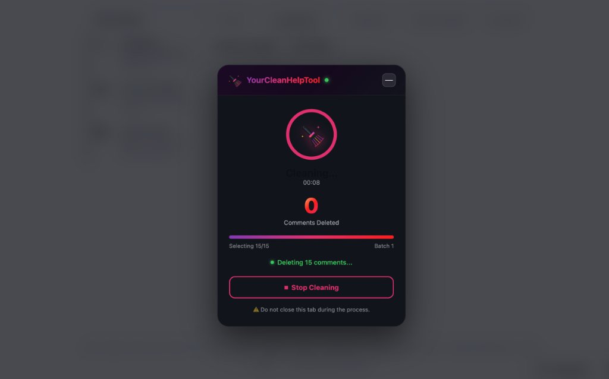
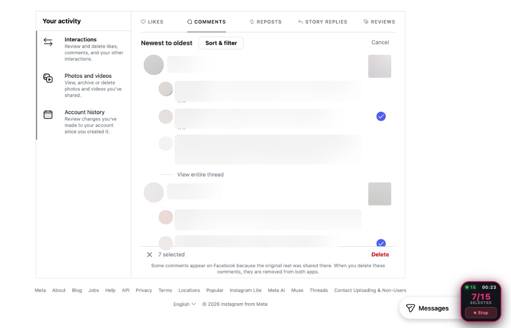

# YourCleanHelpTool: Activity Cleaner

> A privacy-first, client-side Chrome extension (Manifest V3) designed to help users bulk remove their own past interactions (likes, comments, and story replies) on social web platforms.

---

## 🚀 Key Features

* **Unlike Posts**: Automated batch unliking for your past liked posts.
* **Delete Comments**: Bulk deletion of your past comments.
* **Delete Story Replies**: Fast removal of old story interaction replies.
* **Smart Floating Widget**: Compact, non-intrusive in-page floating widget with real-time progress counter, elapsed timer, and one-click stop control.
* **100% Private & Local**: Zero external analytics, zero tracking, and no external servers. Everything runs entirely within your local browser session.
* **Auto-Resume Protection**: Automatically detects temporary rate limits or errors, safely reloads, and resumes progress.

---

## 📸 Screenshots

### Cleaning in Progress (Popup Modal)


### Live In-Page Automation & Floating Widget


---

## 🛠️ How to Install & Run in Developer Mode

You can load and test this extension in Google Chrome, Brave, Arc, or any Chromium-based browser without publishing it.

### Step 1: Open Extensions Page
1. Open Google Chrome.
2. Navigate to `chrome://extensions` in the address bar (or go to **Menu (⋮)** → **Extensions** → **Manage Extensions**).

### Step 2: Enable Developer Mode
1. In the top-right corner of the `chrome://extensions` page, toggle the **"Developer mode"** switch to **ON**.
2. Once enabled, a new top bar with three buttons will appear:
   * **Load unpacked**
   * **Pack extension**
   * **Update**

### Step 3: Load the Unpacked Extension
1. Click **"Load unpacked"**.
2. Select the `YourCleanHelpTool` folder containing `manifest.json`.
3. The extension is now installed! You will see **YourCleanHelpTool: Activity Cleaner** in your extensions list.

### Step 4: Pin Extension to Toolbar
1. Click the **Puzzle Piece icon (🧩)** in Chrome's top-right toolbar.
2. Find **YourCleanHelpTool** and click the **Pin (📌)** icon so it's always accessible.

---

## 🧑‍💻 How to Develop & Debug

### 1. Applying Code Changes (Hot Reloading)
When modifying code, changes to different files require different refresh steps:

* **Modifying `popup.html` or `popup.js`**:
  * Simply close the popup and reopen it. Changes take effect immediately.
* **Modifying `content.js` or `content.css`**:
  1. Go to `chrome://extensions`.
  2. Click the **Refresh icon (🔄)** on the YourCleanHelpTool card.
  3. Reload the Instagram tab (`Cmd + R` or `Ctrl + R`) so the updated content script injects.
* **Modifying `background.js` or `manifest.json`**:
  1. Go to `chrome://extensions`.
  2. Click the **Refresh icon (🔄)** on the YourCleanHelpTool card.

---

### 2. Debugging & Inspecting Logs

Chrome extensions consist of three isolated environments, each with its own console:

#### A. Popup Window (`popup.html` / `popup.js`)
* Right-click the extension icon in the Chrome toolbar.
* Select **"Inspect popup"** (Просмотреть код всплывающего окна).
* DevTools will open specifically for the popup window to view console output and inspect HTML/CSS.

#### B. Background Service Worker (`background.js`)
* Open `chrome://extensions`.
* Locate the **YourCleanHelpTool** card.
* Click the blue **"service worker"** link next to *Inspect views*.
* A dedicated DevTools window will open where you can see background logs, storage events, and network requests.

#### C. In-Page Content Script (`content.js`)
* Open the Instagram tab.
* Press `Cmd + Option + I` (Mac) or `Ctrl + Shift + I` (Windows) to open Chrome DevTools.
* Switch to the **Console** tab. Filter by `[YourCleanHelpTool]` to see all execution logs, batch selection events, and error detections.

---

## 📂 Project Structure

```
YourCleanHelpTool/
├── screenshots/        # Extension screenshots for documentation
│   ├── modal-cleaning.jpg
│   └── comments-widget.png
├── manifest.json       # Manifest V3 extension configuration & permissions
├── background.js       # Background service worker (lifecycle & storage sync)
├── content.js          # In-page automation engine & floating UI widget
├── content.css         # Placeholder stylesheet for content scripts
├── popup.html          # Clean 2x3 grid action popup UI
├── popup.js            # Popup controller & tab launcher
├── logo.svg            # Master high-contrast vector icon
├── logo.png            # High-resolution raster asset (512x512)
├── broom-icon.png      # Popup header brand asset
├── icon16.png          # Chrome toolbar icon (16x16)
├── icon48.png          # Chrome extension management icon (48x48)
├── icon128.png         # Chrome Web Store listing icon (128x128)
├── .gitignore          # Git exclusion rules
└── README.md           # Documentation and development guide
```

---

## 🔒 Privacy & Permissions

* **`storage`**: Used solely for local session counters and UI theme preferences.
* **`activeTab` / `host_permissions` (`https://www.instagram.com/*`)**: Required exclusively to interact with activity management pages upon explicit user request.
* **Zero telemetry**: No third-party scripts, tracking pixels, or remote APIs.

---

## 📜 Disclaimer
YourCleanHelpTool is an independent utility and is not affiliated, associated, authorized, endorsed by, or in any way officially connected with Instagram, Meta Platforms, Inc., or any of their subsidiaries.
